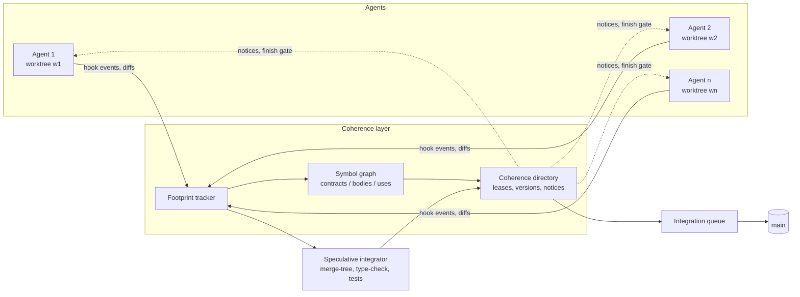

# Concord

**Contract-level coherence for parallel AI coding agents.**

[](https://github.com/lucas-rus/concord/actions/workflows/ci.yml)
[](#license)

Concord is an orchestration engine for running several AI coding agents (Claude Code, OpenHands, ...) **at the same time on the same repository** without them silently breaking each other's work. It is the subject of a Bachelor thesis at the Faculty of Computer Science, West University of Timișoara (supervisor: Dr. Adrian Spătaru).

> **Status:** early development (milestone M0). The symbol/contract engine, the coherence protocol and the offline branch analyzer work and are tested. The live daemon, agent hooks and the CooperBench evaluation are next. See the [roadmap](docs/roadmap.md).

## The problem

Today's parallel-agent setups give each agent its own git worktree. That stops agents from overwriting each other's files, but not from **breaking each other's code**:

- 28% of AI-agent pull requests on GitHub hit merge conflicts ([AgenticFlict](https://arxiv.org/abs/2604.03551)).
- Two cooperating agents succeed about 30% less often than one agent doing both tasks ([CooperBench](https://arxiv.org/abs/2601.13295)).
- The worst failures are invisible to git: patches that ["pass alone but fail together"](https://arxiv.org/abs/2609.25396).

```python
# notify/email.py   (agent A: rate-limit e-mails)     # auth/reset.py   (agent B: password reset)
-def send_email(to, body):                            +def request_reset(user):
+def send_email(to, body, *, user_id):                +    token = tokens.issue(user)
     ...                                              +    send_email(user.email, reset_msg(token))
```

The two agents touch different files, so git merges cleanly, file locks see no conflict, and both branches pass their own tests. The merged program crashes with `TypeError: send_email() missing 1 required keyword-only argument: 'user_id'`. Meanwhile, a third agent that only rewrites the *body* of another function in `notify/email.py` would be blocked by a file lock for no reason.

## The idea

Files are the wrong unit of coordination. Agents break each other through **contracts**: the signatures, types, exported names and schemas that other code depends on. Concord treats every agent's worktree like a CPU cache and every symbol like a cache line, and runs a **coherence protocol** over them:

1. **Infer, don't ask.** It watches what each agent actually reads and edits (hooks, diffs) and maps it onto a symbol graph, giving a *footprint* per agent: symbols read, written, and used by the agent's new code.
2. **Contract vs. body, breaking vs. compatible.** Every symbol is split into its contract and its body. Body edits never block anyone. Contract changes are classified from structured signatures:
   - **breaking**, e.g. a new required parameter;
   - **compatible**, e.g. a new optional parameter, which only produces an informational notice.

   Only concurrent edits to the *same contract* are serialised, through a short lease.
3. **Precise notices + finish gate.** When a contract changes, Concord sends a short, generated notice only to the agents whose footprint depends on it. The notice has the old and new contract and the recipient's exact call sites. An agent cannot finish while it depends on a stale contract.
4. **Speculative integration.** In the background, all branches are merged in memory, type-checked, and the affected tests are run, to catch whatever the contract model misses.

## Try it (works today)

Requires Rust ≥ 1.90 and git ≥ 2.38.

```bash
git clone https://github.com/lucas-rus/concord && cd concord
cargo build --release

# Build the running example: branches agent-a, agent-b, agent-c from a common base.
examples/running-example/setup.sh /tmp/concord-demo

./target/release/concord analyze --repo /tmp/concord-demo --base main agent-a agent-b agent-c --notices
```

Output (abridged):

```text
Findings
  BREAKING   agent-a -> agent-b: notify.email.send_email   (no shared files: invisible to textual merge and file locks)
             now: def send_email(to, body, *, user_id)
             what: new required parameter `user_id`
             auth/reset.py:11  request_reset: send_email(user.email, reset_msg(token))
  FILE       agent-a & agent-c: notify/email.py   disjoint symbols (a file lock would serialise this needlessly)

Textual merge (git merge-tree)
  agent-a & agent-b: clean
  agent-a & agent-c: clean
  agent-b & agent-c: clean

Protocol simulation (notices each agent would receive)
  -> to agent-b
     [concord] BREAKING contract change: notify.email.send_email   v0 -> v1   (by agent-a)
       before: def send_email(to, body)
       after : def send_email(to, body, *, user_id)
       what  : new required parameter `user_id`
       your code that depends on it:
         auth/reset.py:11  request_reset: send_email(user.email, reset_msg(token))
  Finish gates:
     agent-a: open
     agent-b: BLOCKED (1 unresolved)
     agent-c: open
```

Other commands:

```bash
concord symbols path/to/file.py          # symbols, contracts and digests
concord diff old.py new.py               # contract vs. body changes between two versions
concord analyze --base main b1 b2 --json # machine-readable output (for experiments)
```

## First results (RQ1, CooperBench gold patches)

On all **560** Python feature pairs of [CooperBench](https://github.com/cooperbench/CooperBench), Concord's textual merge results agree with CooperBench's own gold conflict report on 560/560 pairs. At symbol level:

- **24%** of pairs share files but touch disjoint symbols, so a file lock would serialise them needlessly.
- **47%** are contract-coupled, but only **13%** through a *breaking* change. Compatibility analysis cuts gating by 72%.
- **15** pairs have a breaking coupling that git merges cleanly.

Details: [eval/rq1/results.md](eval/rq1/results.md).

## Architecture



| Crate | Role | Status |
|---|---|---|
| [`concord-core`](crates/concord-core) | Symbols, contract/body change classification, the coherence protocol (pure state machine), pairwise conflict analysis | ✅ M0 |
| [`concord-lang`](crates/concord-lang) | tree-sitter front-end: Python symbols, normalised contracts, body digests, imports, reference resolution | ✅ M0 (Python) |
| [`concord-git`](crates/concord-git) | git plumbing: tree reading, in-memory `merge-tree`, dirty-worktree snapshots | ✅ M0 |
| [`concord-cli`](crates/concord-cli) | `concord` binary: `symbols`, `diff`, `analyze --notices` | ✅ M0 |
| `concord-daemon` | Host daemon: hook ingestion (HTTP), live directory, notices, finish gate, event log | ⏳ M1 |
| `concord-mcp` | MCP server for agents (`concord_status`, `concord_negotiate`, ...) | ⏳ M2 |

Design: [docs/design.md](docs/design.md) · Tech stack and decisions: [docs/tech-stack.md](docs/tech-stack.md) · Related work: [docs/research/related-work.md](docs/research/related-work.md) · Evaluation plan: [eval/README.md](eval/README.md)

## How it differs from existing tools

| | Unit of coordination | Footprint | Cross-file contract dependencies | Proactive, targeted info |
|---|---|---|---|---|
| Claude Code agent teams | tasks; files by convention | declared by lead | no | free-form messages |
| [Clash](https://github.com/clash-sh/clash) | file (textual merge) | observed diffs | no | pre-edit warning |
| [Grove](https://github.com/NathanDrake2406/grove) | file, hunk, symbol, import | observed diffs | imports/exports | advisory score |
| [Claim Plane](https://github.com/SkeinRank/claim-plane) | declared intents/regions | declared by planner | partially | admission (block) |
| [Gas Town](https://github.com/gastownhall/gastown) Refinery | merge queue | – | at merge time | no |
| **Concord** | **symbols; contract vs. body** | **inferred at run time** | **yes, at run time** | **contract notices + finish gate** |

## License

Licensed under either of [Apache License, Version 2.0](LICENSE-APACHE) or [MIT license](LICENSE-MIT) at your option.
