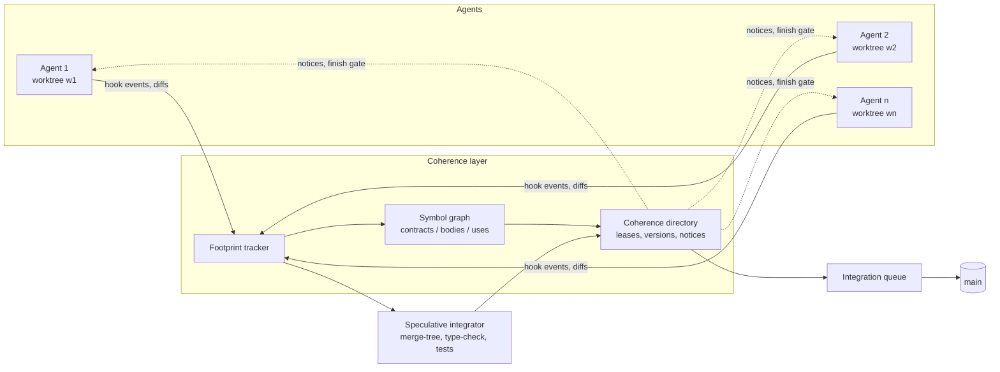

# Concord

**Contract-level coherence for parallel AI coding agents.**

[](https://github.com/lucas-rus/concord/actions/workflows/ci.yml)
[](#license)

Concord is an orchestration engine for running several AI coding agents (Claude Code, OpenCode, ...) **at the same time on the same repository** without them silently breaking each other's work.

> **Status:** working end-to-end CLI & MCP server across **Python, TypeScript/JavaScript, Rust, Go, C/C++, and schemas (SQL, Prisma, Protobuf, OpenAPI)** — symbol/contract engine, live contract + region coherence daemon (`concord run` for Claude Code and OpenCode), conflict-aware task planner (`concord plan`), Tier-2 native type checking (`concord typecheck` / `concord merge --type-check`), live `git worktree` inspector (`concord worktrees`), SASE Merge-Readiness Packs (`concord mrp`), one-command MCP setup (`concord setup`), and a 12-tool MCP server (`concord mcp`). See the [roadmap](docs/roadmap.md) or jump directly to the [benchmark results & tests below](#benchmark-results).

## The problem

Today's parallel-agent setups give each agent its own git worktree. That stops agents from overwriting each other's files, but not from **breaking each other's code**:

- 28% of AI-agent pull requests on GitHub hit merge conflicts ([AgenticFlict](https://arxiv.org/abs/2604.03551)).
- Two cooperating agents succeed about 30% less often than one agent doing both tasks ([CooperBench](https://arxiv.org/abs/2601.13295)).
- The worst failures are invisible to git: patches that ["pass alone but fail together"](https://arxiv.org/abs/2609.25396).

```python
# notify/email.py   (agent A: rate-limit e-mails)     # auth/reset.py   (agent B: password reset)
-def send_email(to, body):                            +def request_reset(user):
+def send_email(to, body, *, user_id):                +    token = tokens.issue(user)
     ...                                              +    send_email(user.email, reset_msg(token))
```

The two agents touch different files, so git merges cleanly, file locks see no conflict, and both branches pass their own tests. The merged program crashes with `TypeError: send_email() missing 1 required keyword-only argument: 'user_id'`. Meanwhile, a third agent that only rewrites the *body* of another function in `notify/email.py` would be blocked by a file lock for no reason.

## The idea

Files are the wrong unit of coordination. Agents break each other through **contracts**: the signatures, types, exported names and schemas that other code depends on. Concord treats every agent's worktree like a CPU cache and every symbol like a cache line, and runs a **coherence protocol** over them:

1. **Infer, don't ask.** It watches what each agent actually reads and edits (hooks, diffs) and maps it onto a symbol graph, giving a *footprint* per agent: symbols read, written, and used by the agent's new code.
2. **Contract vs. body, breaking vs. compatible.** Every symbol is split into its contract and its body. Body edits never block anyone. Contract changes are classified from structured signatures:
   - **breaking**, e.g. a new required parameter;
   - **compatible**, e.g. a new optional parameter, which only produces an informational notice.

   Only concurrent edits to the *same contract* are serialised, through a short lease.
3. **Precise notices + finish gate.** When a contract changes, Concord sends a short, generated notice only to the agents whose footprint depends on it. The notice has the old and new contract and the recipient's exact call sites. An agent cannot finish while it depends on a stale contract.
4. **Speculative integration.** In the background, all branches are merged in memory, type-checked, and the affected tests are run, to catch whatever the contract model misses.

## Benchmark results

**Twelve agents building a full CommonMark 0.31.2 parser in parallel ([`concord-bench`](https://github.com/lucas-rus/concord-bench)).** Twelve parallel OpenCode agents (`opencode-go/hy4-flash-free`) implement all sections of the CommonMark 0.31.2 Markdown→HTML specification from a minimal paragraph-only scaffold, judged by the official **652-example** CommonMark specification suite:

| Condition | Spec examples passed (of 652) | Integration loss | Merge conflicts | Wall-clock time |
|---|---|---|---|---|
| `sequential` (1 agent, ticket-by-ticket) | 645 / 652 (98.9%) | 0 | 0 | 157.1 min (1.0×) |
| `parallel-off` (12 agents, uncoordinated) | 374 / 652 (57.4%) | 268 | 9 / 12 branches | 29.0 min |
| `parallel-integrator` (12 agents + AI integrator) | 643 / 652 (98.6%) | 15 | 0 (resolved by 13th agent) | 56.3 min (2.8×) |
| **`Concord` (`--mode enforce --regions`)** | **652 / 652 (100.0%)** | **0** | **0 / 12 branches** | **31.7 min (5.0×)** |

**Cross-language generalization: six agents building a TypeScript 5 (`strict`) dispatch engine (`dispecerat`) with zero per-ticket test hints ([`concord-bench`](https://github.com/lucas-rus/concord-bench)).** Six parallel OpenCode agents (`opencode-go/hy4-flash-free`) implement coupled features sharing `lib/types.ts`, `DemoBackend`, and `@/lib/...` tsconfig aliases with **no pre-written feature tests** and **no per-ticket `check` commands** (only `--test-cmd ./scripts/run-tests.sh`), judged by a held-out **48-test** suite (42 per-ticket + 6 cross-ticket runtime synergy tests):

| Condition | Held-out spec (of 48) | Cross-ticket synergy | Integration loss | Merge conflicts | Wall-clock time |
|---|---|---|---|---|---|
| `sequential` (1 agent, ticket-by-ticket) | 48 / 48 (100.0%) | 6 / 6 | 0 | 0 / 6 | 13.3 min (1.0×) |
| `parallel-off` (6 agents, uncoordinated) | 21 / 48 (43.8%) | 0 / 6 | 21 | 3 / 6 | 6.0 min |
| `parallel-fileleases` (6 agents, file locks) | 14 / 48 (29.2%) | 0 / 6 | 25 | 4 / 6 | 7.7 min |
| `parallel-integrator` (6 agents + 7th integrator) | 48 / 48 (100.0%) | 6 / 6 | 0 | 0 / 6 (7th agent) | 11.7 min (1.13×) |
| **`Concord` (`--mode enforce --regions`)** | **48 / 48 (100.0%)** | **6 / 6** | **0** | **0 / 6** | **6.0 min (2.20×)** |
| **`Orchestrator + Concord` (autonomous MCP split)** | **48 / 48 (100.0%)** | **6 / 6** | **0** | **0 / 6** | **8.6 min (team)** |

## Install and use it from your agent (MCP)

Concord runs locally, next to your repository, as an [MCP](https://modelcontextprotocol.io) server. Your coding agent (OpenCode, Claude Code, any MCP client) gets tools to start a **team of parallel agents** on the repository, follow it, and fetch one integrated branch; you just ask it in plain language ("split this into parallel tickets and run them with Concord").

**1. Install & auto-connect in one command** (macOS, Linux):

```bash
curl -fsSL https://raw.githubusercontent.com/lucas-rus/concord/main/install.sh | sh -s -- --setup
# or install first, then run setup separately:
curl -fsSL https://raw.githubusercontent.com/lucas-rus/concord/main/install.sh | sh
concord setup   # auto-connects OpenCode, Claude Code, and Cursor
```

*(From source with Rust ≥ 1.90: `cargo install --git https://github.com/lucas-rus/concord concord-cli && concord setup`.)*

**2. Or connect manually:**

OpenCode (one-line CLI, no JSON editing):

```bash
opencode mcp add --global concord -- concord mcp --agent-cli opencode
```

Claude Code (plugin with the MCP server and a `concord-team` skill):

```text
/plugin marketplace add lucas-rus/concord
/plugin install concord@lucas-rus-concord
```

**MCP Tools (12):**
- **Planning, contract inspection & smart merging (for any agent workflow):**
  - `concord_plan` — partition the repository symbol graph into shared contract hubs and producer-first parallel ticket clusters
  - `concord_symbols` — list symbol signatures and line spans without function bodies (~10× fewer tokens than reading whole files; Python, TS/JS, Rust, Go, C/C++, SQL, Prisma, Protobuf, OpenAPI)
  - `concord_diff_contracts` — contract-level diff between revisions or working tree, with impacted callers
  - `concord_worktrees` — zero-mutation live check across all active `git worktree` checkouts (Claude Squad, Cursor worktrees, manual worktrees)
  - `concord_analyze` — check concurrent branches for cross-file contract violations, duplicate symbols, and textual overlaps
  - `concord_smart_merge` — merge branches producer-first with AST-verified insertion union, post-merge call conformance, and $O(\log k)$ test failure bisection
  - `concord_negotiate` / `concord_ack` — propose a signature adjustment to a symbol's live owner or acknowledge a peer's contract change
- **Parallel team orchestration:**
  - `concord_run`, `concord_status`, `concord_result` (includes SASE Merge-Readiness Pack), `concord_cancel`

## Try it from the command line

Requires Rust ≥ 1.90 and git ≥ 2.38.

```bash
git clone https://github.com/lucas-rus/concord && cd concord
cargo build --release

# Build the running example: branches agent-a, agent-b, agent-c from a common base.
examples/running-example/setup.sh /tmp/concord-demo

./target/release/concord analyze --repo /tmp/concord-demo --base main agent-a agent-b agent-c --notices
```

Output (abridged):

```text
Findings
  BREAKING   agent-a -> agent-b: notify.email.send_email   (no shared files: invisible to textual merge and file locks)
             now: def send_email(to, body, *, user_id)
             what: new required parameter `user_id`
             auth/reset.py:11  request_reset: send_email(user.email, reset_msg(token))
  FILE       agent-a & agent-c: notify/email.py   disjoint symbols (a file lock would serialise this needlessly)

Textual merge (git merge-tree)
  agent-a & agent-b: clean
  agent-a & agent-c: clean
  agent-b & agent-c: clean

Protocol simulation (notices each agent would receive)
  -> to agent-b
     [concord] BREAKING contract change: notify.email.send_email   v0 -> v1   (by agent-a)
       before: def send_email(to, body)
       after : def send_email(to, body, *, user_id)
       what  : new required parameter `user_id`
       your code that depends on it:
         auth/reset.py:11  request_reset: send_email(user.email, reset_msg(token))
  Finish gates:
     agent-a: open
     agent-b: BLOCKED (1 unresolved)
     agent-c: open
```

Other commands:

```bash
concord setup                                   # auto-connect OpenCode, Claude Code, and Cursor MCP
concord plan --rev HEAD                         # identify shared hubs & producer-first parallel ticket clusters
concord symbols src/                            # symbol contracts & spans (Py, TS/JS, Rust, Go, C/C++, SQL/Prisma/Proto/OpenAPI)
concord diff old.py new.py                      # contract vs. body changes between two versions
concord worktrees --base main                   # inspect all active git worktrees (incl. uncommitted edits)
concord typecheck --repo .                      # auto-detect & run Tier-2 checker (tsc, pyright/ty, cargo check, go vet)
concord merge --base main b1 b2 --type-check    # contract-ordered smart merge + verified union + conformance + type check
concord mrp .concord/runs/<run-id>              # render SASE Merge-Readiness Pack (markdown or --json)
concord analyze --base main b1 b2 --json        # machine-readable output (for CI & experiments)
concord run --tasks tasks.json --mode enforce --regions --test-cmd "npm test"
```

> **Zero-config acceptance gating:** `tasks.json` only needs `[{"name": "...", "prompt": "..."}]` — when per-ticket `check` commands are omitted, Concord automatically uses `--test-cmd` for finish-gate verification, cross-agent regression gating, and $O(\log k)$ post-merge failure bisection.

### Watch a team live

`concord watch` follows a run as it happens: what each agent is doing, who waits for whom, and every coordination step Concord takes.

```bash
concord watch runs/            # the most recent run under the --out of `concord run`
concord watch runs/ --once     # one snapshot, e.g. for a log
```

```text
concord  1795518603-enforce-463d82  1/12 finished  03:07 · running

  agent             state                              edits notices blocks hand-off combined merges
  code-spans        finished                               4       0      0        0        0      0
  emphasis          working                                8       0      0        0        0      0
  images-autolinks  working                                2       0      0        0        1      0
  lists             working                                5       0      0        0        1      0
  ...

  coordination
  02:26  region    raw-html-breaks yields src/cmark/inlines.py to code-spans
  02:36  combine   lists + headings add at the same place in src/cmark/blocks.py
  02:59  done      code-spans finished
```

## First results (RQ1, CooperBench gold patches)

On all **560** Python feature pairs of [CooperBench](https://github.com/cooperbench/CooperBench), Concord's textual merge results agree with CooperBench's own gold conflict report on 560/560 pairs. At symbol level:

- **24%** of pairs share files but touch disjoint symbols, so a file lock would serialise them needlessly.
- **12%** are contract-coupled, and only **1%** have call sites that actually violate the new contract.
- Test runs confirmed that interference between *gold* patches is rare: 0 of 48 evaluable jinja pairs fail together. The value of Concord shows on *agent* patches (see the live results above).

Details: [eval/rq1/results.md](eval/rq1/results.md).

## Architecture



| Crate | Role | Status |
|---|---|---|
| [`concord-core`](crates/concord-core) | Symbols, contract/body change classification, coherence protocol (leases, duplicate-symbol guard, negotiation, finish gate), pairwise conflict analysis, exhaustive BFS formal model checker | ✅ Complete |
| [`concord-lang`](crates/concord-lang) | Tree-sitter & schema front-ends: symbols, normalised contracts, body digests, imports, reference resolution, affected-test graph | ✅ Python, TS/JS, Rust, Go, C/C++, Schemas |
| [`concord-git`](crates/concord-git) | Git plumbing: tree reading, in-memory `merge-tree`, patience/diff3 verified insertion-union, worktree snapshots & listing | ✅ Complete |
| [`concord-cli`](crates/concord-cli) | `concord` binary: `setup`, `plan`, `symbols`, `diff`, `analyze`, `worktrees`, `typecheck`, `merge`, `mrp`, `run`, `watch`, `mcp` (12 MCP tools + authenticated TCP daemon) | ✅ Complete |

**Languages.** Concord's symbol and contract engine covers **Python** (`.py`, `.pyi`), **TypeScript/JavaScript** (`.ts`, `.tsx`, `.mts`, `.cts`, `.js`, `.jsx`, `.mjs`, `.cjs`, including `@/...` and `~/...` tsconfig root path aliases), **Rust** (`.rs`), **Go** (`.go`), **C/C++** (`.c`, `.h`, `.cc`, `.cpp`, `.cxx`, `.hh`, `.hpp`, `.hxx`), and **schema/API contracts** (`.sql`, `.prisma`, `.proto`, OpenAPI `.json`/`.yaml`). Files in other languages still participate in textual/structural merge checks and file-existence guards.

Design: [docs/design.md](docs/design.md) · Tech stack and decisions: [docs/tech-stack.md](docs/tech-stack.md) · Related work: [docs/research/related-work.md](docs/research/related-work.md) · Evaluation plan: [eval/README.md](eval/README.md)

## How it differs from existing tools

| | Unit of coordination | Footprint | Cross-file contract dependencies | Proactive, targeted info |
|---|---|---|---|---|
| Claude Code agent teams | tasks; files by convention | declared by lead | no | free-form messages |
| [Clash](https://github.com/clash-sh/clash) | file (textual merge) | observed diffs | no | pre-edit warning |
| [Grove](https://github.com/NathanDrake2406/grove) | file, hunk, symbol, import | observed diffs | imports/exports | advisory score |
| [Weave](https://github.com/Ataraxy-Labs/weave) / [Aura](https://github.com/Naridon-Inc/aura) | AST entities | declared MCP claims | no (same-file entity merge) | entity claim conflict |
| [Claim Plane](https://github.com/SkeinRank/claim-plane) | declared intents/regions | declared by planner | partially | admission (96.7% serialised) |
| [Gas Town](https://github.com/gastownhall/gastown) Refinery | merge queue | – | at merge time | no |
| **Concord** | **symbols; contract vs. body + regions** | **inferred at run time** | **yes, live + post-merge** | **surgical notices + finish gate + MRP** |

## License

Licensed under either of [Apache License, Version 2.0](LICENSE-APACHE) or [MIT license](LICENSE-MIT) at your option.
