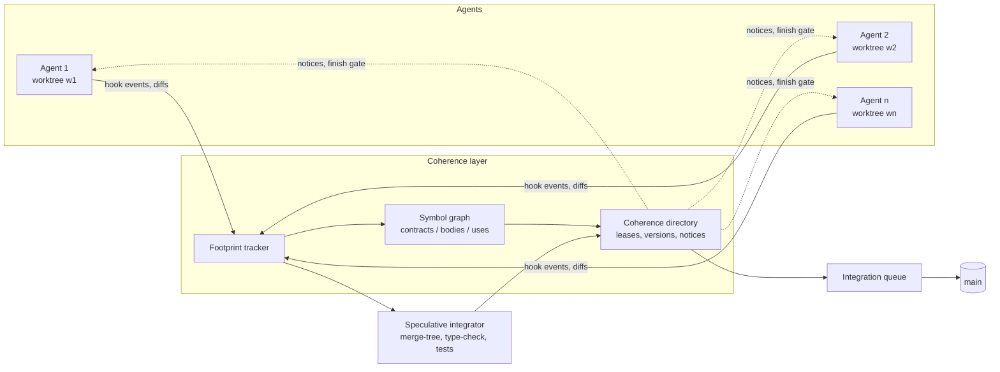

# Concord

**Contract-level coherence for parallel AI coding agents.**

[](https://github.com/lucas-rus/concord/actions/workflows/ci.yml)
[](#license)

Concord is an orchestration engine for running several AI coding agents (Claude Code, OpenCode, ...) **at the same time on the same repository** without them silently breaking each other's work. It is the subject of a Bachelor thesis at the Faculty of Computer Science, West University of Timișoara (supervisor: Dr. Adrian Spătaru).

> **Status:** research prototype, usable. Working: the symbol/contract engine, the coherence protocol, the offline analyzer, live coordination of real agents (`concord run`, with Claude Code or OpenCode), peer merge, and an MCP server so your own agent can start and follow coordinated teams. See the [roadmap](docs/roadmap.md).

## The problem

Today's parallel-agent setups give each agent its own git worktree. That stops agents from overwriting each other's files, but not from **breaking each other's code**:

- 28% of AI-agent pull requests on GitHub hit merge conflicts ([AgenticFlict](https://arxiv.org/abs/2604.03551)).
- Two cooperating agents succeed about 30% less often than one agent doing both tasks ([CooperBench](https://arxiv.org/abs/2601.13295)).
- The worst failures are invisible to git: patches that ["pass alone but fail together"](https://arxiv.org/abs/2609.25396).

```python
# notify/email.py   (agent A: rate-limit e-mails)     # auth/reset.py   (agent B: password reset)
-def send_email(to, body):                            +def request_reset(user):
+def send_email(to, body, *, user_id):                +    token = tokens.issue(user)
     ...                                              +    send_email(user.email, reset_msg(token))
```

The two agents touch different files, so git merges cleanly, file locks see no conflict, and both branches pass their own tests. The merged program crashes with `TypeError: send_email() missing 1 required keyword-only argument: 'user_id'`. Meanwhile, a third agent that only rewrites the *body* of another function in `notify/email.py` would be blocked by a file lock for no reason.

## The idea

Files are the wrong unit of coordination. Agents break each other through **contracts**: the signatures, types, exported names and schemas that other code depends on. Concord treats every agent's worktree like a CPU cache and every symbol like a cache line, and runs a **coherence protocol** over them:

1. **Infer, don't ask.** It watches what each agent actually reads and edits (hooks, diffs) and maps it onto a symbol graph, giving a *footprint* per agent: symbols read, written, and used by the agent's new code.
2. **Contract vs. body, breaking vs. compatible.** Every symbol is split into its contract and its body. Body edits never block anyone. Contract changes are classified from structured signatures:
   - **breaking**, e.g. a new required parameter;
   - **compatible**, e.g. a new optional parameter, which only produces an informational notice.

   Only concurrent edits to the *same contract* are serialised, through a short lease.
3. **Precise notices + finish gate.** When a contract changes, Concord sends a short, generated notice only to the agents whose footprint depends on it. The notice has the old and new contract and the recipient's exact call sites. An agent cannot finish while it depends on a stale contract.
4. **Speculative integration.** In the background, all branches are merged in memory, type-checked, and the affected tests are run, to catch whatever the contract model misses.

## Install and use it from your agent (MCP)

Concord runs locally, next to your repository, as an [MCP](https://modelcontextprotocol.io) server. Your coding agent (OpenCode, Claude Code, any MCP client) gets tools to start a **team of parallel agents** on the repository, follow it, and fetch one integrated branch; you just ask it in plain language ("split this into parallel tickets and run them with Concord").

**1. Install the binary** (macOS, Linux):

```bash
curl -fsSL https://raw.githubusercontent.com/lucas-rus/concord/main/install.sh | sh   # to ~/.local/bin
# or from source:
cargo install --git https://github.com/lucas-rus/concord concord-cli
```

**2. Connect it.**

OpenCode (`~/.config/opencode/opencode.jsonc`):

```jsonc
"mcp": {
  "concord": {
    "type": "local",
    "command": ["concord", "mcp", "--agent-cli", "opencode", "--model", "opencode/qwen4-max-free"],
    "enabled": true
  }
}
```

Claude Code (plugin with the MCP server and a `concord-team` skill):

```text
/plugin marketplace add lucas-rus/concord
/plugin install concord@lucas-rus-concord
```

**Tools:** `concord_run` (start a team: one agent and git worktree per ticket), `concord_status`, `concord_result` (report and integration branch), `concord_analyze` (check existing branches for conflicts and broken contracts), `concord_cancel`. The team's agents are Claude Code (`--agent-cli claude`) or OpenCode (`--agent-cli opencode`) with the model you choose.

## Try it from the command line

Requires Rust ≥ 1.90 and git ≥ 2.38.

```bash
git clone https://github.com/lucas-rus/concord && cd concord
cargo build --release

# Build the running example: branches agent-a, agent-b, agent-c from a common base.
examples/running-example/setup.sh /tmp/concord-demo

./target/release/concord analyze --repo /tmp/concord-demo --base main agent-a agent-b agent-c --notices
```

Output (abridged):

```text
Findings
  BREAKING   agent-a -> agent-b: notify.email.send_email   (no shared files: invisible to textual merge and file locks)
             now: def send_email(to, body, *, user_id)
             what: new required parameter `user_id`
             auth/reset.py:11  request_reset: send_email(user.email, reset_msg(token))
  FILE       agent-a & agent-c: notify/email.py   disjoint symbols (a file lock would serialise this needlessly)

Textual merge (git merge-tree)
  agent-a & agent-b: clean
  agent-a & agent-c: clean
  agent-b & agent-c: clean

Protocol simulation (notices each agent would receive)
  -> to agent-b
     [concord] BREAKING contract change: notify.email.send_email   v0 -> v1   (by agent-a)
       before: def send_email(to, body)
       after : def send_email(to, body, *, user_id)
       what  : new required parameter `user_id`
       your code that depends on it:
         auth/reset.py:11  request_reset: send_email(user.email, reset_msg(token))
  Finish gates:
     agent-a: open
     agent-b: BLOCKED (1 unresolved)
     agent-c: open
```

Other commands:

```bash
concord symbols path/to/file.py          # symbols, contracts and digests
concord diff old.py new.py               # contract vs. body changes between two versions
concord analyze --base main b1 b2 --json # machine-readable output (for experiments)
```

### Watch a team live

`concord watch` follows a run as it happens: what each agent is doing, who waits for whom, and every coordination step Concord takes.

```bash
concord watch runs/            # the most recent run under the --out of `concord run`
concord watch runs/ --once     # one snapshot, e.g. for a log
```

```text
concord  1795518603-enforce-463d82  1/12 finished  03:07 · running

  agent             state                              edits notices blocks hand-off combined merges
  code-spans        finished                               4       0      0        0        0      0
  emphasis          working                                8       0      0        0        0      0
  images-autolinks  working                                2       0      0        0        1      0
  lists             working                                5       0      0        0        1      0
  ...

  coordination
  02:26  region    raw-html-breaks yields src/cmark/inlines.py to code-spans
  02:36  combine   lists + headings add at the same place in src/cmark/blocks.py
  02:59  done      code-spans finished
```

## Results with real agents

**A small project built by a team.** Three Haiku agents build [`conta`](examples/conta) (an offline version of a Romanian invoice-processing pipeline) over three milestones, each split into three parallel tickets in which one agent changes an interface the others use. Hidden acceptance tests, validated against a reference solution, check the integrated result. 3 runs per condition ([eval/project](eval/project)):

| | hidden tests passed (of 33) | milestones complete | merge conflicts |
|---|---|---|---|
| without Concord | 15.3 (46%) | 0 / 9 | 3 / 9 |
| contract layer only | 24.0 (73%) | 3 / 9 | 3 / 9 |
| peer merge only | 22.0 (67%) | 3 / 9 | 0 / 9 |
| **Concord (both)** | **32.0 (97%)** | **7 / 9** | **0 / 9** |

The two mechanisms fix different failures: the contract layer fixes interface changes (removed or changed functions other agents call), and peer merge fixes overlapping edits.

**CooperBench pairs with agents.** 32 randomly sampled CooperBench feature pairs (jinja, click, dirty-equals, dspy), two Haiku agents each, judged by CooperBench's hidden tests ([eval/coop](eval/coop)): both features pass in **1/32** pairs without Concord and **13/32** with Concord (p = 0.0005, exact McNemar). Most CooperBench failures are overlapping edits, which peer merge resolves.

**Shop scenario.** Three agents on ordinary tickets, one of which makes `currency` a required argument of `price_order` ([eval/live](eval/live/README.md)): integrated tests pass in **0/3** runs without Concord and **3/3** with it (Haiku, ≈ $0.03 per run). A first run with Qwen 4 Max through OpenCode also passes with Concord; the comparison without Concord is in progress.

## First results (RQ1, CooperBench gold patches)

On all **560** Python feature pairs of [CooperBench](https://github.com/cooperbench/CooperBench), Concord's textual merge results agree with CooperBench's own gold conflict report on 560/560 pairs. At symbol level:

- **24%** of pairs share files but touch disjoint symbols, so a file lock would serialise them needlessly.
- **12%** are contract-coupled, and only **1%** have call sites that actually violate the new contract.
- Test runs confirmed that interference between *gold* patches is rare: 0 of 48 evaluable jinja pairs fail together. The value of Concord shows on *agent* patches (see the live results above).

Details: [eval/rq1/results.md](eval/rq1/results.md).

## Architecture



| Crate | Role | Status |
|---|---|---|
| [`concord-core`](crates/concord-core) | Symbols, contract/body change classification, the coherence protocol (pure state machine), pairwise conflict analysis | ✅ M0 |
| [`concord-lang`](crates/concord-lang) | tree-sitter front-ends: symbols, normalised contracts, body digests, imports, reference resolution | ✅ Python, TypeScript/JavaScript |
| [`concord-git`](crates/concord-git) | git plumbing: tree reading, in-memory `merge-tree`, dirty-worktree snapshots | ✅ M0 |
| [`concord-cli`](crates/concord-cli) | `concord` binary: `symbols`, `diff`, `analyze --notices` | ✅ M0 |
| `concord-daemon` | Host daemon: hook ingestion (HTTP), live directory, notices, finish gate, event log | ⏳ M1 |
| `concord-mcp` | MCP server for agents (`concord_status`, `concord_negotiate`, ...) | ⏳ M2 |

**Languages.** Concord's symbol analysis covers **Python** (`.py`, `.pyi`) and **TypeScript/JavaScript** (`.ts`, `.tsx`, `.mts`, `.cts`, `.js`, `.jsx`, `.mjs`, `.cjs`; declaration files, `*.min.js` and `node_modules` are skipped). The front-end is picked by file extension; files in other languages still take part in textual merge checks, but get no symbol-level notices. The TypeScript front-end is syntactic (tree-sitter, no `tsc`): relative imports and re-exports (`export ... from`) are resolved inside the repository, package imports are treated as external, interfaces and enums are classes and type aliases are variables, and type annotations are part of a contract.

Design: [docs/design.md](docs/design.md) · Tech stack and decisions: [docs/tech-stack.md](docs/tech-stack.md) · Related work: [docs/research/related-work.md](docs/research/related-work.md) · Evaluation plan: [eval/README.md](eval/README.md)

## How it differs from existing tools

| | Unit of coordination | Footprint | Cross-file contract dependencies | Proactive, targeted info |
|---|---|---|---|---|
| Claude Code agent teams | tasks; files by convention | declared by lead | no | free-form messages |
| [Clash](https://github.com/clash-sh/clash) | file (textual merge) | observed diffs | no | pre-edit warning |
| [Grove](https://github.com/NathanDrake2406/grove) | file, hunk, symbol, import | observed diffs | imports/exports | advisory score |
| [Claim Plane](https://github.com/SkeinRank/claim-plane) | declared intents/regions | declared by planner | partially | admission (block) |
| [Gas Town](https://github.com/gastownhall/gastown) Refinery | merge queue | – | at merge time | no |
| **Concord** | **symbols; contract vs. body** | **inferred at run time** | **yes, at run time** | **contract notices + finish gate** |

## License

Licensed under either of [Apache License, Version 2.0](LICENSE-APACHE) or [MIT license](LICENSE-MIT) at your option.
